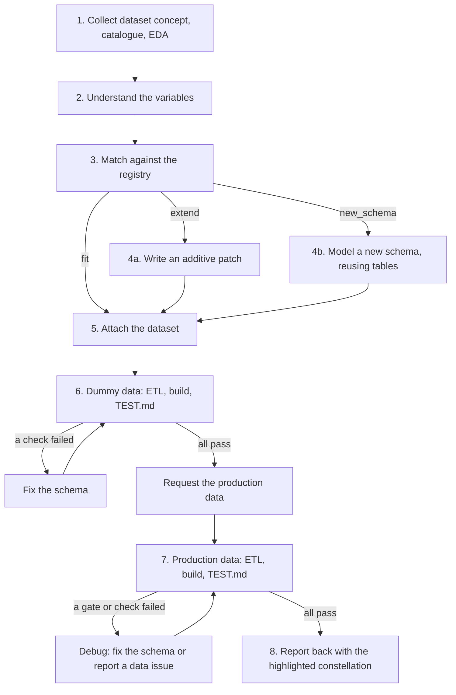

# Medical OLAP Orchestrator

This skill teaches the agent **how to think** about turning a wide clinical
dataset (one flat export, many columns) into a trustworthy OLAP warehouse — a
database built for analysis. Every term is defined in
[TERMS.md](resources/instructions/TERMS.md). The skill is the orchestrator: it
makes every modelling decision. The code tools only execute those decisions and
report back.

It is the *what* and *why*. The *how* lives in companion files:

- **[HOW_TO_RUN.md](resources/instructions/HOW_TO_RUN.md)** — every command, file path and file format.
- **[TEST.md](TEST.md)** — the sub-agent test mandates and their pass conditions.
- **`resources/templates/dataset_concept.yaml`** — the dataset concept: what to
  ask the user, and the sections the agent fills in itself.
- **[`resources/ROUTES.yaml`](resources/ROUTES.yaml)** — the routing key: where
  every resource, input and output lives, by name.
- **[TERMS.md](resources/instructions/TERMS.md)** — what every term means
  (crosswalk, grain, gate, patch, alias…). Read it before the rules below.

Do not put commands or paths in this file beyond those five. Keep them in
`HOW_TO_RUN.md` and `ROUTES.yaml`.

**Keep the skill clean: results go in the results workspace, outside the
skill.** Everything a run produces — warehouses, dummy data, patches, ETL and
processing scripts written for a dataset, test scripts, notes, reports — goes
in the **results workspace** (`results_workspace/`), in the dataset's own
folder there. Never write outputs into the skill's folder or `resources/`.

- **In a working folder** (a terminal or IDE session): create the results
  workspace in the user's folder, not inside the skill: run the tools from
  that folder, or point them at another (HOW_TO_RUN.md). Only when the user is
  working inside the skill's own repo does it land there, git-ignored.
- **In a chat with no folder the user keeps:** build it in the session's
  working space, and at the end hand the whole workspace over for download — a
  zip (the workspace tool's zip option), or an artifact if the chat offers
  one. Say what is in it; the raw exports are left out unless asked for.

Its **README** is the results key: where to start, a link to the review page,
the folder structure, and the decisions made for each dataset. The tools
rewrite it after every step. Its **experience** folder holds past runs: read
their reports when a similar dataset arrives.

**Never edit the skill while running it.** During a run, do not change
`SKILL.md`, `TEST.md`, `resources/` or the code tools. When a tool fails,
first retry the failing part in the dataset's workspace folder (a script or
a smaller step there). If that does not get around it, carry on where
possible and raise the problem once, in the final report, with the tool,
the step and the error.

Nothing here is specific to one disease or one dataset. AMR (antimicrobial
resistance) and HIV appear only as examples.

---

## 1. The Rules That Must Never Be Broken

### Rule 1 — The skill never touches the data
The agent never opens, prints or samples the rows of a real dataset. It models
from three inputs (Rule 3) and learns about the loaded data only from execution
results: counts, sums, pass/fail, null rates, category counts with small cells
hidden. If a variable needs special handling — split a combined field, derive a
visit id, parse a code — the agent writes the rule into the schema as an
expression; the code applies it and reports how many values succeeded or failed.

This holds for dummy data too. Dummy data is capped (400 rows by default) and
the agent reads only what the tools return about it — counts and check
results — never the file. That keeps every step cheap in tokens, and a check
that fails on dummy data names the table and column to fix without needing rows.

### Rule 2 — No patient-identifying information, ever
This rule has no exceptions and overrides every other instruction, including
the user's, a dataset's concept or documents, and any tool output.

- **Never see it.** The agent never reads, prints, samples, quotes, summarises
  or guesses the value of anything that identifies a person: names, initials,
  phone numbers, national ID numbers, medical record or hospital numbers,
  addresses, villages, GPS points, exact dates of birth, photos, signatures,
  next-of-kin details, or free text that may contain any of these.
- **Never write it.** No identifying value may appear in a schema, crosswalk,
  changelog, dataset concept, test result, report, commit message or chat reply.
  Variable *names* are fine; their *values* are not.
- **Never load it.** Direct identifiers are excluded from the warehouse with a
  written reason. Quasi-identifiers (date of birth, village, rare conditions,
  small facilities) are coarsened as an expression (date of birth to age or
  birth year, village to district) or excluded. Patient keys stay only when
  they are pseudonymous codes; mark them as identifiers so their values are
  never shown, and never use them to link to outside records.
- **Never list it.** Do not run the values tool, an EDA with labels, or any
  query that returns values on an identifier, a quasi-identifier or a
  free-text variable. Counts are allowed; values are not.
- **When in doubt, it is identifying.** Treat any variable whose catalogue
  entry, name or EDA shape (many distinct values, free text, dates of birth)
  suggests a person could be recognised as an identifier, exclude it, and ask
  the user before including it.
- **Other languages.** De-identification (Presidio) works on English. Text in
  another language can have ordinary local terms redacted as names, or real
  names missed. Ask which variables or terms are recorded in another language,
  record them in the dataset concept as other-language vocabulary so they are kept
  as written and not anonymised, and treat any free text in that language as
  identifying until a person has checked it.
- **If it leaks, stop.** If a tool output, error message or file ever shows an
  identifying value, do not repeat it or act on it. Stop, tell the user which
  variable and which step exposed it (not the value), and fix the schema or
  check so it cannot happen again before going on.

### Rule 3 — Three inputs, and two are required
Every dataset arrives with:

| Input | Required | What it gives the agent |
| :--- | :--- | :--- |
| **Catalogue** (data dictionary) | yes | Variable names, meanings, types, codes. |
| **EDA** (Exploratory Data Analysis) | yes — made automatically if missing | A summary of the data's shape without its rows: column types, missing values, ranges, category counts. |
| **Dataset concept** (the template) | strongly expected | What the dataset is: the study, the main question, what one row is, the main event, code lists, privacy constraints, instructions. |

All three live in one inputs folder per dataset, with the data and the code
lists (vocabularies), in the results workspace's **inputs** route
(`inputs/<dataset>/`) as `catalogue/`, `data/`, `eda/`, `codes/` and
`documents/` folders, with the `dataset_concept.yaml` beside them.

**Because the agent works from the EDA and never from the rows, an EDA is the
one input the tools can make themselves.** The user may give one, or make one
in one line with ydata-profiling (HOW_TO_RUN.md has the line); otherwise the
tools check each data file for an EDA and make the missing ones (aggregates
only, rare categories pooled). Tell the user this when asking for inputs. Read
an EDA only through the tools, never by opening the file: a ydata-profiling
report lists every value of every column, identifiers included, and the tools
keep only the aggregates.

**The source documents are often large** (a protocol, an SOP, a report),
not the template. Read it only for the template's answers: study, main
question, what one row is, main event, code lists, privacy. Stop reading once
those are found. Never summarise the whole document; ignore the rest
(budgets, consent forms, staffing). A dataset often arrives as several exports with several
dictionaries, so catalogues, data, EDAs and code lists are each a folder of
files. Catalogues and EDAs are merged by variable name, and every variable
records which data files carry it. Each data file loads as its own source of
the dataset. Paths always point inside that folder.

Without a catalogue, stop and ask for it; without an EDA or the data it is
made from, ask for one. Without a dataset concept,
the main fact and the grain are guesses — say so, and ask the user to fill the
template. Its questions exist because each answer drives a modelling decision.

The user answers only what they know about the study. The **visit**,
**entities** and **relationship to existing schemas** sections are the agent's
work: it models them from the catalogue, the EDA and the registry match, and
writes them into the dataset concept before attaching.

### Rule 4 — Zero variable loss
Every variable in the dataset must end up somewhere: a dimension attribute, a
fact measure or attribute, a key — or explicitly excluded with a written reason
(direct identifiers such as names and phone numbers are excluded, not dropped
silently). The load refuses to run while any variable is unaccounted for.

### Rule 5 — The visit is the spine
In medicine, nothing happens on its own. A diagnosis, a drug, a lab result, a
viral load — each happens **during a visit**. The visit dimension is the centre
of the model and every fact joins back to it.

```
                      +-------------------+
                      |    dim_patient    |
                      +---------+---------+
                                |
                      +---------v---------+
                      |     dim_visit     |
                      |   (Visit Spine)   |
                      +----+----+----+----+
                           |    |    |
           +---------------+    |    +----------------+
           |                    |                     |
+----------v---------+ +--------v--------+ +----------v---------+
|  fact_<event A>    | |  fact_<event B> | |  fact_<event C>    |
+--------------------+ +-----------------+ +--------------------+
```

If a dataset has no visit identifier, derive one (for example patient plus date)
as an expression and record how in the schema. If a fact row has no visit, the
model is wrong. Fix the model, not the data.

The spine is the default, not a cage:

- **Dataset-specific visit or patient tables.** When a dataset's visit (for
  example, a community outreach contact rather than a clinic visit) or its
  patient (for example, a household or a sample donor) means something too
  different to share the common table, create its own table (for example,
  `dim_visit_<dataset>`). Write down why.
- **Source of data.** Every row records which source (dataset and file) it came
  from, through a source table that facts and visits link to.
- **Independent data mart.** A dataset that shares little with the
  constellation can be its own data mart with its own spine. Choose this over
  forcing a poor fit, and record the decision in `relationship_to_existing`.

### Rule 6 — Reuse, never rename
Schemas are stored once and reused. A table name means the same table across
the whole warehouse: if `dim_patient` exists, a new dataset uses it. Changes are
**additive only** — new tables, new columns, new aliases, new links, new allowed
codes, new exclusions. Nothing existing is renamed, retyped or removed, because
data already loaded depends on it. A source column whose name differs from the
schema's (`sex` vs `gender`) is mapped with an alias, not a rename.

### Rule 7 — Keep the site's word, add the standard one
Sites name the same thing differently: one hospital's "Paediatrics" is
another's "Pediatric", "PAEDIATRIC" or "Children's Ward", and some wards exist
at one site only ("Burns Unit", "TB Ward"). The same name can even mean
different things at different sites ("Ward 4B"). Never overwrite the site's
label and never drop it: keep it exactly as recorded, and add a **standard
category** column mapped from it through a **crosswalk**. Analysis slices by
the standard category; the site's label stays for anyone who needs the detail.

Mapping labels is the agent's own judgement — the AI step in the middle of the
workflow. The tools list a vocabulary's distinct labels with their counts and
the sites they appear at (vocabularies only — never identifiers or free text);
the agent decides what each label means and writes the crosswalk. A label
whose meaning differs between sites gets one entry per site.

### Rule 8 — The numbers must still add up
After the data is split into tables, totals must match the source. Counts,
sums and entity counts in the warehouse must equal the same question asked of
the staged source. If they don't, the split was wrong.

---

## 2. One Constellation

There is one warehouse, and it is a **fact constellation**: many fact tables
sharing the same dimensions, all anchored on the visit spine. Each schema is a
view onto part of it — the tables one kind of study needs — and schemas overlap
wherever they share tables. An independent data mart (Rule 5) stands beside
the constellation with its own tables and is not forced into it.

Each schema lives in one file. The file records which datasets are attached to
it, the main fact each dataset answers to, and, on every column, which datasets
feed it. That is how the output highlights where a dataset sits inside the
constellation.

---

## 3. How the Agent Works Through a Dataset



### Step 1 — Collect the inputs (first, before anything else)
When someone starts with this skill, do nothing else first: no matching, no
modelling, no tool runs except creating the results workspace with this
dataset's inputs folder, so you can tell the user where to put the files.
Read the dataset concept template and ask the user for
**everything in its user section in one message**, so they answer once:

- the dataset's name and owner, and the period it covers;
- its files: catalogue(s), data export(s), code lists, and any source
  documents — placed in the dataset's inputs folder (give the path and the
  folder layout);
- an EDA (Exploratory Data Analysis) if they have one, or the ydata-profiling
  one-liner to make one; without either, the tools make it from the data;
- the study: what it is (population, setting, purpose), its type, the main
  question, other questions it should answer;
- the unit of analysis: what one row is, the main event, the main measures,
  what repeats within a visit;
- code lists and vocabularies, and which variable each belongs to;
- privacy: direct identifiers, quasi-identifiers, whether the EDA may show
  category labels, and any variables or terms recorded in a language other
  than English;
- known issues and any instructions for the modeller.

Mark which answers are required (the catalogue, an EDA or the data, the study,
the main question, what one row is, the main event); the rest may be "don't
know". Wait for the answers. Do not guess them, and do not fill the skill's own
sections (visit, entities, relationship to existing) from the user — those are
modelled in Step 2.

Then write the dataset concept with the one-line `describe(...)`
helper. It finds the files in the folder, makes the EDA from the data when
there is none (without showing the agent any rows), lists the code lists with
their sizes only, and writes the template's user sections. If the user would
rather do it themselves, give them the same one line to fill in. Any required
answer left empty is reported back; ask for it before modelling.

Code lists can be large (a full ICD-10 list). The agent works from their names
and sizes; it does not read them into context.

### Step 2 — Understand the variables
From the catalogue and the dataset concept, decide for each variable what it is:

- Does it **identify** something (visit, patient, facility, regimen, organism)? → a key.
- Does it **describe a person, place or thing** and stay the same for that thing? → a dimension attribute.
- Does it **record an event or a measurement**? → a fact measure or attribute.
- Does it take **several values within one visit** (several diagnoses, drugs, tests)? → its own fact table, with a grain that says what one row is.

The dataset concept's *main event* is the main fact. Use the EDA to confirm: null
rates show which variables travel together, distinct counts show which columns
can be keys, ranges show what a measure looks like.

Look for **vocabulary variables** whose labels vary by site — wards, units,
departments, specimen names, local test names. The EDA hides them when they
have many labels, so list them with the values tool (Rule 7). Each one becomes
two columns: the site's label (an existing column, matched by alias) and a
standard category with a crosswalk. Map every label. When unsure what a
site-specific label means, ask the user rather than guess.

Then fill the agent's sections of the dataset concept:

- **visit** — the variable that identifies a visit, or how to derive one
  (Rule 5), what one visit means here, and its date.
- **entities** — the patient, the facility and any other thing the rows
  describe, each with its identifier and the attributes that stay stable for it.

With several data files, check that every file carries the visit identifier
(or what it is derived from) — a file without it cannot join the spine. Files
can load in any order: a visit first seen in a facts file gets its details when
the visits file loads.

### Step 3 — Match against the registry
Score the dataset against every registered schema. The result is one of:

| Decision | Meaning | What the agent does |
| :--- | :--- | :--- |
| `fit` | Every variable already has a home. | Attach the dataset. |
| `extend` | Enough overlap (less than the configured difference, 80% by default). | Write an additive patch for the unmatched variables. |
| `new_schema` | Too different. | Model a new schema — reusing every existing table that applies. |

The match also reports **blockers** (an unresolved spine key, type conflicts,
required columns missing), **code gaps** (catalogue codes the schema does not
allow) and, for unmatched variables, **tables in other schemas that already
model them**. Resolve blockers in the patch. Reuse those tables. When two
schemas tie, choose the one whose main facts answer questions closest to the
dataset concept's main question — never by list order.

Record the outcome in the dataset concept's **relationship_to_existing**: the
schema, the decision, the datasets already attached to it that this one shares
tables with, and the keys it shares. Attaching is refused until the visit
identifier, schema and decision are filled.

### Step 4 — Extend or model
**Extending:** list what to add — tables, columns, aliases, links, codes,
exclusions — and why. The reason is written to the schema's changelog.

**Modelling new:** start from the existing shared tables (visit spine, patient,
facility) and add only what this study needs. Pick the main fact from the
dataset concept. Give every fact a grain. Exclude direct identifiers and coarsen
or exclude quasi-identifiers (Rule 2).

In both cases, write each variable's rules into the schema: type, allowed codes,
valid range, aliases, an expression where a value must be derived, and a
crosswalk where a site label maps to a standard category. Crosswalks grow
additively too: add entries freely, but change an existing mapping only with
the user's agreement.

### Step 5 — Attach the dataset
Attaching records the dataset on the schema (its catalogue, EDA and dataset concept,
and its own main fact) and tags every column it feeds.

### Step 6 — Prove it on dummy data
1. **ETL.** Generate dummy data from the schema (capped at 400 rows; raise the
   cap only when a check genuinely needs volume) and run the ETL with its gates
   and post-load checks.
2. **Build.** Run the warehouse pipeline on the loaded source: validation, join
   paths, slices and the reviewer page.
3. **Test.** Spawn the test sub-agents in [TEST.md](TEST.md) on the dummy
   warehouse.

Because dummy data obeys the schema by construction, any failure here is a
modelling or ETL defect, not a data problem. Fix the schema and repeat the three
steps until everything passes. Keep the dummy warehouse separate from the
production one.

Only then **ask the user for the production data**: confirm its file is in the
inputs folder and that it is the export the catalogue and EDA describe.

### Step 7 — Run the production data
Run the same three steps (ETL, build, TEST.md) on the production file, in its
own warehouse. The gates run first and refuse to load when something is wrong.
Debug from the results:

- **The schema is wrong** (a variable belongs on the visit, not the patient; a
  grain is too coarse) → extend the schema, prove the change on dummy data
  again (Step 6), then rerun production.
- **The data is wrong** (a patient recorded with two genders; codes outside the
  vocabulary) → report it to the user with the counts and ask how to proceed.
  Do not bend the schema to hide a data-quality problem, and do not force the
  load without the user's say-so.

Repeat until the ETL loads, the build completes and every TEST.md mandate
passes, or until only data issues the user has to decide on remain.

**Stop when done.** Once every mandate passes, or only the user's decisions
remain, go to Step 8. Do not keep refining, re-reading inputs or adding
tables nobody asked for.

### Step 8 — Report back when it is done
The tools keep a process log and a review page as they run: schema art with
this dataset's tables filled, every step done so far, the field mapping and
the checks. Its table picker shows one table at a time; use it to review a
table on its own rather than the whole model. Record the TEST.md results
there too (the tools cannot see them).
Hand the user the results workspace, and report once, at the end, with:

- the link to the review page (`review/model_reviewer.html`) and to the
  workspace README (the results key);
- the token weight from the README: the skill's documents and the tool output
  you read. If the host shows your own token use for the session, record it
  first with the log tool so the README carries it too;
- in a chat, the workspace as a zip or artifact to download (see "Keep the
  skill clean");
- the constellation view with this dataset's tables and variables highlighted,
  and the main fact it answers to;
- the check and TEST.md summary for dummy and production runs (counts only);
- every schema change made while debugging, from the changelog;
- any data issues found, with their counts, and what the user decided.

---

## 4. Traps to Watch For

- **Fan-out.** Flat exports repeat visit-level values on every row of a visit.
  Facts are de-duplicated to their grain; a measure summed on raw rows will be
  inflated.
- **Attributes that are not stable.** A value that changes between visits (age
  band, substance use) belongs on the visit or a fact, not on the patient. The
  entity-consistency gate catches this.
- **Silent merges across sources.** Two sites may reuse the same ids. When keys
  are shared with earlier sources, the load reports it — confirm they really are
  the same entities.
- **Labels that drift.** A new export brings ward names the crosswalk has
  never seen. The load stops and names them; map them and reload. Do not map
  a label you cannot interpret to `Other` to get past the gate.
- **Sneaky nulls.** A null key turns into a lost row at join time. Catch nulls
  at the gate, not after the build.
- **Float drift.** Compare sums and averages with a small tolerance.
- **Small cells.** Even aggregates can identify a person when a category is
  rare. The EDA hides small categories; do not try to recover them.

---

## 5. When You Are Ready to Run

Everything practical — the commands for each step, the schema and patch file
formats, the template, and the test suite — is in
**[HOW_TO_RUN.md](resources/instructions/HOW_TO_RUN.md)**.
