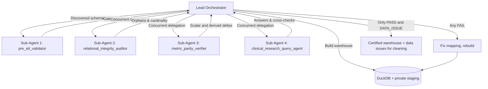

# Semantic Test Suite (`TEST.md`)

This file defines **what must be proven** about a generated OLAP warehouse, not how to prove it for
any one dataset. Terms (grain, staging, gate, crosswalk, fan-out, generated key, data issue) are
defined in [TERMS.md](resources/instructions/TERMS.md); modelling rules are in [SKILL.md](SKILL.md);
commands are in [HOW_TO_RUN.md](resources/instructions/HOW_TO_RUN.md).

There are no fixed column names, table names or ready-made SQL here. The skill discovers the schema
at run time, so the tests are discovered at run time too: each sub-agent gets an objective and
writes its own queries against the schema that actually exists. Sub-agents are expected to **write
tests of their own**: they hold the raw staging table (the source of truth), so they can invent a
check and compute its correct answer without anyone supplying it ([section
4](#4-generating-a-test-and-its-expected-value)). The tests below are worked examples of that
method, not its limit.

**The goal is a full transfer, not cleaning.** Every value of the source must arrive in the
warehouse exactly as recorded (cast to its type, or derived from it by a stated rule). A problem in
the source itself (a value out of range, a code outside the vocabulary, a patient recorded with two
sexes) is not a test failure: it is a `DATA_ISSUE`, reported for the data owner to clean, as long as
the warehouse reproduces it exactly.

---

## 0. The Data Boundary

The orchestrating skill never touches real data (SKILL.md, Rule 1), and that binds its sub-agents
too.

| Warehouse | What a sub-agent may return |
| :--- | :--- |
| **Dummy** (generated from the schema and the EDA, 400 rows by default) | Aggregates and check results only. It may name the failing table, column and at most three key values (never of an identifier column): dummy data obeys the schema, so the failing check already says what to fix, and rows only cost tokens. |
| **Real** | Aggregates only: counts, sums, averages, pass/fail, group counts with groups under the small-cell threshold (5) suppressed. Never rows, key values (source or generated) or free text. |

Where a test below asks for "offending rows", report at most three key values from the dummy
warehouse; on real data report the count and the column or group instead.

**Where the oracle lives.** The warehouse file holds only generated keys (`PAT-000001`,
`FAC-000001`, `VIS-000001`); no source identifier is in it. The raw staged sources and the key map
are in the private staging database beside it. Open both read-only:

```python
con = duckdb.connect("<warehouse>.duckdb", read_only=True)
con.execute("ATTACH '<warehouse>_staging.duckdb' AS stg (READ_ONLY)")
# raw table:  stg.stg_<source>        key map: stg._keymap(dimension, natural_key, surrogate_key, source_id)
```

To compare a raw entity with its warehouse row, join through `stg._keymap` (`dimension = '<dim
table>'`, `natural_key` = the raw identifier, `surrogate_key` = the warehouse key). Return counts
only. The staging tables still hold direct identifiers (names, phone numbers): never select their
values.

Prove every test on dummy data first. A test that fails on dummy data is a modelling or ETL defect.
A test that passes on dummy data and finds an anomaly on real data that the raw table shows
identically is a `DATA_ISSUE`.

### Built-in checks

The load already runs a generated check for most mandates, from the schema alone (results in the
`etl --json` output). Sub-agents start from these and add their own where the schema allows
something they do not cover.

| Mandate | Built-in checks (`error` blocks the load; `data_issue` never does) |
| :--- | :--- |
| `pre_etl_validator` | errors: `variable_coverage`, `spine_key_present`, `spine_key_nulls` (a blank part of a derived key counts as null), `cast_failures`, `derived_completeness`, `crosswalk_coverage`, `fact_grain`. Data issues: `allowed_values`, `value_range`, `required_nulls`, `entity_consistency`. Info: `keys_shared_with_other_sources` |
| `relational_integrity_auditor` | `orphan_keys`, `entity_coverage`, `lineage`, `spine_coverage` (info) |
| `metric_parity_verifier` | `fact_row_parity`, `measure_sum_parity`, `value_parity` (every value of every table equals the source's), `derived_parity` (each derived column) |
| `clinical_research_query_agent` | none: its questions come from the dataset concept's main and secondary questions |

The built-in parity checks read the loader's own output, so they prove the load. The sub-agents
start from the **original raw columns**: for a derived variable, they take the raw inputs and apply
the same derivation steps themselves, in their own query on the raw table (Test 12).

---

## 1. The One Rule That Makes This Work

**The raw staging table is the only source of truth.** There is no second one: never a number copied
from an earlier run, a report, the EDA or the schema.

```
expected  :=  <the question, asked of the raw staging table>
actual    :=  <the same question, asked of the warehouse>
pass      :=  actual agrees with expected
```

The warehouse is a rearrangement of the raw file. Any question answerable from both must give the
same answer. That is the whole test suite.

---

## 2. The Four Mandates

Each sub-agent exists to prove one thing. The mandates are fixed; the tests that satisfy them are
not.

| Sub-agent | What it must prove |
| :--- | :--- |
| `pre_etl_validator` | The raw data could be transferred in full: every variable has a home, keys are complete, every value can be cast or derived. Source problems are listed as data issues. |
| `relational_integrity_auditor` | No fact row is orphaned; entity counts survived; generated keys map one to one onto the source's entities. |
| `metric_parity_verifier` | Sums, averages and every derived feature still match the raw file. |
| `clinical_research_query_agent` | Real clinical questions return sensible answers. |

Read each mandate as the objective and the tests as **worked examples**, not a checklist. A
sub-agent that finds a better way to prove its mandate should take it and say so.

---

## 3. How Sub-Agents Get Their Targets

Before any sub-agent runs, the orchestrator hands it the **discovered schema context**:

| Context item | Meaning |
| :--- | :--- |
| `warehouse` / `staging_db` | The warehouse file and its private staging database (section 0). |
| `raw_table` | `stg.stg_<source>`: the unmodified source rows, all text. |
| `spine_table` / `spine_key` | The visit (encounter) dimension and its key, and how the source identifies a visit (a variable, or a derivation such as patient + date). |
| `dimensions` | Each dimension, its source identifier, and its attributes. Its warehouse key is generated. |
| `facts` | Each fact table, its grain, its foreign keys, and its numeric measures. |
| `coded_columns` | Columns drawn from a fixed vocabulary, with the vocabulary observed in the raw data. |
| `derived_columns` | Every column computed rather than copied, with its raw inputs and its derivation steps (the schema's expression, or its crosswalk file). |
| `known_data_issues` | The load's data issues (check, column, count), so a reproduced anomaly is recognised as one. |

A sub-agent never assumes a name. It reads this context, or asks the database, then writes its own
queries. In the templates below, everything in `<angle brackets>` comes from the context: it is a
shape, not a query.

---

## 4. Generating a Test and Its Expected Value

Follow this whenever the listed tests do not cover something the schema makes possible.

1. **Find something that must be true.** Ask what the rearrangement could have broken. A column
   moved into a dimension keeps its values. A measure keeps its total, average and spread. A foreign
   key still resolves. A categorical column keeps its distribution. Two facts sharing a parent do
   not inflate each other when joined. A derived column equals its derivation on the raw inputs. Any
   invariant you can state in one sentence, you can test.
2. **Write the question so both sides can answer it.** Phrase it once ("What is the total
   `<measure>` by `<attribute>`?"), then translate it twice: the raw table read directly, and the
   warehouse fact joined out to the dimension. A question only one side can answer is a sanity
   check, not a parity test: label it so.
3. **Compute the expected value, never assume it.** Run the raw side first and take its answer as
   the expectation. Ask both sides in one statement, so nothing stale can creep in:

   ```sql
   WITH expected AS ( <the question, asked of the raw table> ),
        actual   AS ( <the same question, asked of the warehouse> )
   SELECT * FROM expected FULL OUTER JOIN actual USING (<group keys>)
   WHERE <values differ beyond tolerance>;   -- match NULL group keys with IS NOT DISTINCT FROM
   ```
4. **Choose a tolerance and justify it.** Counts and keys: exact. Floating-point measures: relative,
   about `1e-9`. Currency and large values: a small absolute tolerance, stated. Averages over
   different row counts are supposed to differ: compare the counts first and report that instead. A
   pass at the wrong tolerance is not a pass.
5. **Make the failure useful.** Collect the rows (dummy) or counts (real) that disagree, the
   actual/expected ratio (near a whole number means fan-out, near zero a filter), and whether the
   build applied a filter the raw side did not.
6. **Check the test before blaming the model.** A failing generated test is as likely to be wrong as
   the model: usually the oracle ignored a filter the build applied, read raw rows that repeat per
   visit (fan-out), or grouped on an attribute that is not unique per entity. Re-derive the expected
   value once, deliberately, before reporting a model defect.

---

## 5. The Testing Workflow



---

## 6. Sub-Agent 1 — `pre_etl_validator`

Proves the raw data could be transferred in full. It refuses a build that would lose or change a
value; it lists source problems without blocking.

### Gate 1 — Nothing gets left behind
- **Objective:** every raw column appears in at least one planned table, or is excluded with a
  written reason.
- **How to derive:** list the raw columns, list the columns named across the build plan (an
  expression's inputs count), compare the sets.
- **Pass:** no unmapped raw column. **Report:** the names of any.

### Gate 2 — The spine key is complete
- **Objective:** every row identifies its visit (encounter).
- **How to derive:** count rows where the spine key, or any input of a derived spine key, is null,
  blank or unreadable (a blank patient id in `patient_id + visit_date` is a missing key, not a key).
- **Pass:** zero. **Report:** the count, and a sample of offending rows (dummy).

```sql
SELECT COUNT(*) FROM <raw_table> WHERE NULLIF(TRIM(<each key input>), '') IS NULL;
```

### Gate 3 — Keys are keys
- **Objective:** an entity key identifies one entity.
- **How to derive:** for each dimension's source identifier, check that each value carries one
  consistent set of attribute values across the raw rows.
- **Result:** a conflict is a `DATA_ISSUE` when the warehouse kept a value the source holds (the
  first recorded) and the count matches the raw table; report the key column, the attribute and the
  count. It is a `FAIL` when the conflict shows the attribute is modelled on the wrong table (it
  changes every visit): then it belongs on the visit or a fact.

> This catches silent merging before it happens: if a key fails here,
> `SELECT DISTINCT` would quietly merge two real entities later.

### Gate 4 — Coded values stay inside their vocabulary
- **Objective:** categorical columns hold only values the data supports.
- **How to derive:** do **not** start from a known code list. Profile each low-cardinality column,
  read its observed distinct values, decide whether the set is a deliberate vocabulary (few values,
  high repetition) or free text. For a vocabulary, record the observed set as the baseline and flag
  values that deviate in casing, whitespace or obvious typo distance from a dominant value.
- **Result:** deviants are a `DATA_ISSUE` (transferred as recorded, listed for cleaning), with the
  column, its inferred vocabulary and each deviant's row count.

> Example of the reasoning: three dominant values plus four rows carrying a
> lowercase or padded variant of one of them is a normalisation issue in the
> source, not four new categories.

### Gate 5 — Every value can be cast
- **Objective:** a typed column (number, date) can hold every value the source gives it: a value
  that fails to cast would be lost in transfer.
- **How to derive:** for each typed column, count non-blank raw values that fail to cast.
- **Pass:** zero. A failure is a `FAIL` (a transfer loss): the column needs a type that holds the
  value, or a stated derivation. **Report:** the column and the count (dummy: sample values). Values
  that cast but fall outside the schema's range are a `DATA_ISSUE`.

### Gate 6 — Every derived variable can be derived from the original
- **Objective:** wherever the original inputs of a derived variable are filled, the derivation
  gives a value, so nothing is lost on the way.
- **How to derive:** apply the derivation steps to the original columns in the raw table, and count
  rows where every input is filled but the steps give no value. Example: `age_at_visit` from
  `date_of_birth` and `visit_date`; a row with date of birth `'UNKNOWN'` gives no age, and is
  counted. A row whose input is blank is not counted: there is nothing to derive.
- **Pass:** zero. **Report:** the derived variable, its inputs, the count.

---

## 7. Sub-Agent 2 — `relational_integrity_auditor`

Runs after the build. Proves the pieces still connect.

### Test 1 — No orphan rows
- **Objective:** every fact row links to a row in each table it references.
- **How to derive:** enumerate every foreign key of every fact (and of every dimension that links
  another) from the schema context. For each, left-join to its parent and count misses. Do this for
  *all* of them, not only the spine.
- **Pass:** every orphan count is zero. **Report:** one row per relationship: child, parent, key,
  orphan count.

```sql
SELECT COUNT(*) FROM <child_table> f LEFT JOIN <parent_table> p ON f.<fk> = p.<parent_key>
WHERE f.<fk> IS NOT NULL AND p.<parent_key> IS NULL;
```

### Test 2 — Entity counts survived
- **Objective:** splitting the file did not create or lose entities.
- **How to derive:** for each dimension, compare its row count (for this source) with the count of
  distinct non-blank source identifiers in the raw table, and with the key map's entries for that
  dimension.
- **Pass:** all three equal. **Report:** dimension, raw distinct, key map, built, difference.

> Built **above** raw distinct: the dimension is not de-duplicated on its key,
> usually an attribute that varies per row got pulled in. **Below:** rows were
> filtered out.

### Test 3 — Coverage of the spine
- **Objective:** every visit in the raw file exists in the spine, and the spine invents nothing.
- **How to derive:** map the raw visit identifiers to generated keys through the key map, then
  compare with the spine's keys in both directions.
- **Pass:** both difference sets empty. **Report:** counts missing from the spine, and counts
  present only in it.

### Test 4 — Generated keys and attribute fidelity
- **Objective:** each generated key stands for exactly one source entity, and an attribute's values
  did not change when it moved into a dimension.
- **How to derive:** check the key map is one to one per dimension (no natural key with two
  generated keys, none the reverse), and that no warehouse table holds a source identifier. Then,
  for each dimension attribute, compare its value distribution (value, count of distinct entities)
  in the raw table with the dimension's, joined through the key map. Sample if the table is wide.
- **Pass:** one to one, no source identifier, distributions match (entities recorded two ways are
  the Gate 3 `DATA_ISSUE`). **Report:** attribute and any value whose count differs.

---

## 8. Sub-Agent 3 — `metric_parity_verifier`

Proves the arithmetic and every derivation survived. **Every expected value is computed from the raw
table in the same query.**

> **Fan-out first.** A flat export repeats visit-level values on every row of a
> visit (one row per drug, test or diagnosis). The oracle for a visit-level
> measure is the raw table reduced to one row per visit, and for a fact the raw
> table reduced to that fact's grain, never the raw rows. Check first that the
> reduced value is unambiguous (no visit with two different values).

### Test 5 — Sum parity, for every measure found
- **Objective:** totals are unchanged.
- **How to derive:** do not wait for a list of measures. Enumerate the numeric columns of every fact
  from the schema context and test **all** of them.
- **Pass:** each delta within tolerance (relative about `1e-9`, or absolute `1e-3` for
  currency-scale values; state which). **Report:** measure, raw total, warehouse total, delta,
  tolerance.

```sql
SELECT (SELECT SUM(<measure>) FROM (<raw_table reduced to the fact's grain>)) AS expected,
       (SELECT SUM(<measure>) FROM <fact_table>)                               AS actual;
```

> **Watch the filter.** If a fact holds only rows where its columns are present,
> the raw side must apply the same filter. A filtered fact against an
> unfiltered raw total is a false failure.

### Test 6 — Average and distribution parity
- **Objective:** each measure keeps its shape, not just its total.
- **How to derive:** compare `AVG`, `MIN`, `MAX` and the non-null count per measure.
- **Pass:** all within tolerance. **Report:** measure, statistic, expected, actual, delta.

> Averages catch what sums miss: duplicated rows plus introduced nulls can
> balance a sum, but not the average and the non-null count together.

### Test 7 — Group-by parity
- **Objective:** slicing by a dimension attribute gives the raw file's answer.
- **How to derive:** pick attributes with useful cardinality (more than one value, not unique per
  row), including derived ones such as a crosswalk's standard category. Group the raw table by the
  attribute and the warehouse by the same attribute through its joins; compare group by group.
- **Pass:** identical groups, counts and totals. **Report:** attribute and any differing group.

### Test 8 — Fan-out does not inflate
- **Objective:** joining two facts through a shared parent does not multiply rows.
- **How to derive:** for each pair of facts sharing a parent, total a measure of one across the
  joined result, collapsed back to **that fact's own grain**, and compare with its raw total.
- **Pass:** equal, not a multiple. **Report:** the pair, the measure, joined total, raw total,
  ratio.

```sql
-- collapse to one row per row of fact_a (its full grain), never per parent alone:
-- a fact finer than the visit (one row per drug) would lose rows that share a value
SELECT SUM(<measure>) FROM (
  SELECT DISTINCT a.<each grain column of fact_a>, a.<measure>
  FROM <parent_table> p
  JOIN <fact_a> a ON p.<parent_key> = a.<fk>
  LEFT JOIN <fact_b> b ON p.<parent_key> = b.<fk>);
```

> A ratio near a whole number is the signature of fan-out: the total was
> multiplied by the average number of matching child rows.

### Test 12 — Derived variables match the same steps applied to the original
- **Objective:** a derived variable in the warehouse (age from date of birth, a visit id from
  patient + date, suppressed from a viral load, a crosswalk's standard ward type) holds exactly what
  its derivation gives when applied to the original raw columns.
- **How to derive:** for each derived variable, take its derivation steps from the context (the
  schema's expression, or the crosswalk file: labels matched ignoring case and spacing, site-scoped
  entries first). Apply the **same steps** to the original columns in the raw table, at the table's
  grain. Map entities through the key map and compare with the warehouse, value for value.
- **Pass:** zero differing values. **Report:** the variable, rows compared, differing count
  (dummy: up to three keys). A derived value that faithfully reproduces a source anomaly (a
  sentinel `-1` read as "suppressed") is a `DATA_ISSUE`: name its effect on the variable.

---

## 9. Sub-Agent 4 — `clinical_research_query_agent`

Proves the warehouse is *usable*, not just consistent: a model can pass every parity check and still
be impossible to query.

### Test 9 — Compose questions from the schema
- **Objective:** the warehouse answers real analytical questions, starting with the dataset
  concept's main and secondary questions.
- **How to derive:** write the questions from the schema found: one measure, aggregated, grouped by
  one or two attributes reachable by joins, optionally filtered by a third. Cover different facts
  and join depths, including at least one crossing from a fact through the spine to a dimension the
  fact does not reference directly. State each denominator (per patient, per visit, per test) and
  why.
- **Pass:** every query runs, returns rows, and reconciles with the same question asked of the raw
  file. **Report:** each question in plain language, its SQL, its result, the raw cross-check.

### Test 10 — Proportions are coherent
- **Objective:** breakdowns behave like breakdowns.
- **How to derive:** for each categorical attribute, each value's share within its group, with a
  window function.
- **Pass:** shares sum to 100% per group and match the raw file's. **Report:** attribute, group, any
  share that does not close.

### Test 11 — Joins are reachable and short
- **Objective:** any dimension can be reached from any fact.
- **How to derive:** build the join graph from the schema context; check every fact–dimension pair
  connects; note each path length.
- **Pass:** no unreachable pair. **Report:** any disconnected pair, and any path longer than
  expected for the schema.

---

## 10. Reporting Format

Every sub-agent returns the same structure for every test:

```
TEST:       <what invariant was being proven>
DERIVED:    <the targets it chose, and how it chose them>
QUERY:      <the SQL it actually ran>
EXPECTED:   <value computed from the raw table, and the query that computed it>
ACTUAL:     <value from the warehouse>
TOLERANCE:  <exact | relative 1e-9 | absolute 1e-3>, and why
RESULT:     PASS | FAIL | DATA_ISSUE
DETAIL:     <on failure/issue: the offending rows (dummy) or count (real), actual vs expected>
ORIGIN:     listed | generated
```

- **`PASS`**: the warehouse agrees with the raw oracle within tolerance.
- **`FAIL`**: the warehouse departs from the raw oracle, or a value could not be transferred. An ETL
  or modelling defect.
- **`DATA_ISSUE`**: an anomaly (out-of-range value, non-vocabulary code, inconsistent entity
  attributes) that the raw table shows **identically**: the warehouse reproduced the source with no
  loss or drift. Reported to the user as a finding for cleaning (the workspace README lists them),
  never a failure.

`DERIVED` matters as much as `RESULT`: a pass on the wrong target is not a pass, and the
orchestrator can only catch that if the sub-agent says what it picked. `ORIGIN` marks whether the
test came from this file or the sub-agent wrote it; generated tests are welcome, and flagging them
lets the orchestrator weigh a failure (a new test is more likely to be wrong than an established
one).

---

## 11. When a Test Fails

1. The sub-agent reports the **exact** query and the **exact** delta, not a summary: the
   orchestrator needs the literal failure to reason about it.
2. The orchestrator classifies it:
   - *Model defect*: the mapping is wrong. Fix the table definition, derivation, crosswalk or grain.
   - *Test defect*: the sub-agent compared against the wrong baseline, usually by ignoring a filter
     or the fact's grain. Fix the comparison query.
   - *Source data issue*: the anomaly is identical in the raw table (lowercase typos, sentinel
     negative numbers, conflicting demographics). Mark it `DATA_ISSUE`, document it in the report,
     keep the raw value.
3. For a model or test defect, rebuild only what changed, then re-run **that** sub-agent.
4. Once it passes, re-run the others too: fixing one mapping routinely breaks another.

Repeat until every sub-agent reports only `PASS` and `DATA_ISSUE`.

---

## 12. What This Suite Deliberately Does Not Do

- It does not check clinical plausibility: whether a value is *medically* sensible is a domain
  question outside what the raw file can prove.
- It does not clean the source. A correct warehouse reproduces a wrong source faithfully, and the
  error is reported, not fixed.
- It does not assert absolute numbers. Every threshold is a tolerance or a comparison, never a
  constant from an earlier run.

---

## 13. Negative Tests

Positive tests prove the model preserves valid data. **Negative tests prove the guards catch, flag
or reject invalid data.** Run them generically, on any schema, by corrupting a temporary copy and
checking the guard fires.

| Guard under test | Injected anomaly (one per test) | Pass condition |
| :--- | :--- | :--- |
| Gate 1: variable coverage | A fictitious unmapped column (`_unmapped_temp_col`) | `variable_coverage` fails, build halts |
| Gate 2: spine key | A spine key (or an input of a derived one) set to NULL, blank or whitespace | `spine_key_nulls` counts it, build refuses |
| Gate 3: entity consistency | Two rows sharing an entity key with conflicting stable attributes (gender, birth date) | `entity_consistency` reports it as a data issue with the key count; nothing silently merged |
| Gate 4: vocabulary | A value outside the vocabulary (`'INVALID_CODE'`, a lowercase variant) | `allowed_values` data issue with the row count |
| Gate 5: cast and range | An uncastable string (`'N/A'`, `'UNKNOWN'`) in a typed column; a negative value where min ≥ 0 | `cast_failures` fails (a transfer loss); the out-of-range value is a `value_range` data issue |
| Gate 6: derivation | An unparseable input behind a derived column (e.g. `'UNKNOWN'` date of birth) | `derived_completeness` fails with the count |
| Relational integrity | A fact row with a non-existent parent key (`'NON_EXISTENT_ID'`) | orphan count > 0 |
| Fan-out | Duplicate parent rows for one entity key | row inflation detected, joined ratio > 1.0 |

**Protocol:**

1. **Isolation.** Never corrupt the warehouses or staging. Work in an in-memory database with both
   attached read-only, on temporary copies (`CREATE TEMP TABLE stg_negative AS SELECT * FROM
   stg.<raw_table> LIMIT 50`).
2. **Deterministic mutation.** Change exactly one invariant per test, on a row that was valid before
   (mutating an already anomalous row hides the delta).
3. **Pass criteria.** The test **passes** only if the guard flags the violation and reports exactly
   the injected count. It **fails** if the build completes without noticing (silent data corruption)
   — report it as a defect in the guard, with the check and the file.
