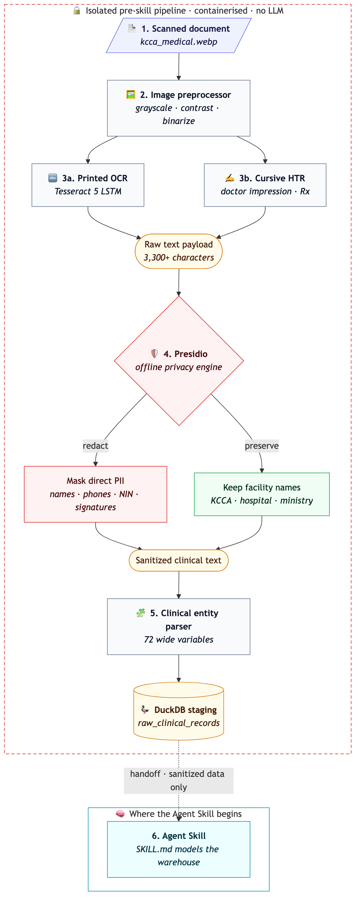
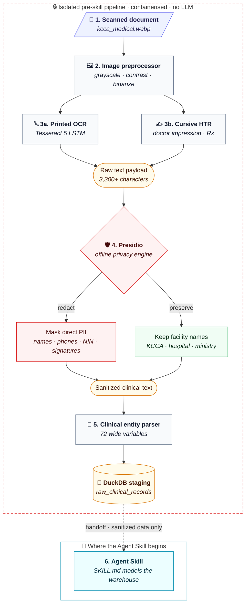

# OCR & Clinical Intake Digitization Pipeline

This document visualizes and defines the **OCR and De-Identification Pipeline** for digitizing paper clinical intake forms, laboratory slips, and medical records before they ever reach the analytical warehouse.

> [!IMPORTANT]
> **No Agent Skill is involved at this stage.**
> The OCR pipeline is a strictly isolated, deterministic data-engineering toolchain executed in a containerized environment. The Agent Skill ([`SKILL.md`](../../SKILL.md)) operates **only** on sanitized tabular catalogues, EDA profiles, and dimensional schemas. Raw patient images and OCR text recognition are segregated to guarantee patient privacy and eliminate LLM dosage hallucination risks.

---

## 1. Pipeline Architecture Diagram

<p align="center">
  
</p>

<details>
<summary><b>Mermaid source</b> (renders on GitHub; edit <code>ocr_assets/ocr_pipeline.mmd</code> and re-render the PNG)</summary>



Re-render after editing:

```bash
npx -y @mermaid-js/mermaid-cli -i resources/instructions/ocr_assets/ocr_pipeline.mmd \
    -o resources/instructions/ocr_assets/ocr_pipeline.png -b white -s 2 -w 900
```

</details>

<details>
<summary><b>Plain-text version</b> (for terminals and viewers without Mermaid)</summary>

```text
┌───────────────────── ISOLATED PRE-SKILL PIPELINE · no LLM ──────────────────────┐
│                                                                                 │
│   1. Scanned document          paper forms (kcca_medical.webp)                  │
│            │                                                                    │
│            ▼                                                                    │
│   2. Preprocessor              grayscale · contrast · binarize                  │
│            │                                                                    │
│      ┌─────┴──────┐                                                             │
│      ▼            ▼                                                             │
│   3a. Printed   3b. Cursive    Tesseract LSTM  +  cursive recognizer            │
│      OCR          HTR                                                           │
│      └─────┬──────┘                                                             │
│            ▼                                                                    │
│   Raw OCR payload              3,303 characters · 100 lines                     │
│            │                                                                    │
│            ▼                                                                    │
│   4. Presidio engine           redacts: names · phone · NIN · signatures        │
│            │                   keeps:   facility headers                        │
│            ▼                                                                    │
│   5. Entity parser             72 wide variables mapped for analysis            │
│                                                                                 │
└────────────┬────────────────────────────────────────────────────────────────────┘
             │
             ▼  handoff: sanitized data only
┌──────────────────────────── WHERE THE AGENT SKILL BEGINS ───────────────────────┐
│                                                                                 │
│   6. DuckDB staging  ──▶  7. SKILL.md execution                                 │
│   raw_clinical_records    visit-spine modelling, star/constellation schemas     │
│                           and SQL queries                                       │
│                                                                                 │
└─────────────────────────────────────────────────────────────────────────────────┘
```

</details>

### Stages at a glance

| # | Stage | Module | In → Out |
| :-: | :--- | :--- | :--- |
| 1 | Preprocessing | [`ocr_tools/preprocessor.py`](../code_tools/ocr_tools/preprocessor.py) | scanned image → clean 1-bit image in 4 regions |
| 2 | Dual recognition | [`ocr_tools/tesseract_runner.py`](../code_tools/ocr_tools/tesseract_runner.py), [`ocr_tools/cursive_recognizer.py`](../code_tools/ocr_tools/cursive_recognizer.py) | image → raw text |
| 3 | Privacy & redaction | [`privacy_tools/presidio_engine.py`](../code_tools/privacy_tools/presidio_engine.py) | raw text → sanitized text |
| 4 | Field extraction | [`ocr_tools/entity_parser.py`](../code_tools/ocr_tools/entity_parser.py) | sanitized text → 72-variable wide record |
| — | Handoff | DuckDB `raw_clinical_records` | wide records → Agent Skill |

---

## 2. Why No Agent Skill is Involved

The boundary between the **OCR toolchain** and the **OLAP Agent Skill** is strictly maintained for three clinical data engineering reasons:

1. **Zero Data Leakage (Patient Privacy)**: Raw paper documents contain direct patient identifiers (full names, mobile numbers, Ugandan National Identification Numbers). Feeding unredacted scanned text into an LLM context window violates privacy boundaries. Microsoft Presidio must sanitize the payload *offline* before anything touches an agent.
2. **Deterministic Dosage & AST Extraction**: Large language models can hallucinate or round critical numeric clinical values (e.g., misinterpreting `0.5g` as `5g`, or flipping an antimicrobial susceptibility test from `Susceptible (S)` to `Resistant (R)`). The OCR engine operates as a deterministic parser with explicit regex lexicons.
3. **Skill Domain Separation**: The `olap_swifter` Agent Skill ([`SKILL.md`](../../SKILL.md)) is specialized in **multidimensional schema architecture** (star/constellation schemas, join graphs, DuckDB SQL, and latency-budgeted slicing). It begins its work once a tabular data structure or staging table is available.

---

## 3. Pipeline Stages Breakdown

### Stage 1: Preprocessing ([`ocr_tools/preprocessor.py`](../code_tools/ocr_tools/preprocessor.py))
- **Grayscale Conversion**: Eliminates color noise from paper background and stamps.
- **Contrast Enhancement (2.0x)**: Accentuates faded ink and carbon copy text.
- **Adaptive Thresholding / Binarization**: Converts to clean 1-bit black/white pixels.
- **Bounding Box Geometry**: Divides the clinical document into 4 lineage quadrants:
  - `header`: Facility, authority, ministry
  - `patient_details`: Demographics, age, gender, attendance
  - `clinical_findings`: Triage symptoms, vital signs, diagnostic checkboxes
  - `rx_and_labs`: Laboratory requests, prescribed antibiotics, referrals

### Stage 2: Dual Recognition ([`ocr_tools/tesseract_runner.py`](../code_tools/ocr_tools/tesseract_runner.py) & [`ocr_tools/cursive_recognizer.py`](../code_tools/ocr_tools/cursive_recognizer.py))
- **Primary Printed OCR**: Runs Tesseract 5 with LSTM neural network line finding.
- **Tail-End Cursive / HTR**: Specialized pass (`--psm 6 --oem 1`) with morphological loop-closing filter to extract handwritten doctor impressions, notes, and signatures.
- **Lexicon Normalization**: Expands Latin clinical abbreviations (`tds` -> Three Times Daily, `PO` -> Oral, `Inj` -> Injection) and matches against canonical antimicrobials (`Ceftriaxone`, `Amoxicillin`, `Ciprofloxacin`).

### Stage 3: Privacy & Redaction ([`privacy_tools/presidio_engine.py`](../code_tools/privacy_tools/presidio_engine.py))
> **Limitation — English only.** Presidio's models and our patterns are English. On text in another language (Luganda, Swahili, French…) it can redact ordinary local words as names and miss names it does not recognise. Flag vocabulary recorded in another language in the dataset description (`privacy.other_language_vocabulary`) and pass it as `keep_terms` (`TesseractRunner(keep_terms=[...])`): those terms are kept as written, never anonymised. Names written in that language still need a person to check them.

**Example.** The text `Next of kin: Bakazi ward. Patient Name: Nakato. Phone: 0772 123 456`, where "Bakazi" (Luganda for "women") is part of a ward name and is flagged with `keep_terms=["Bakazi"]`:

| | Bakazi (flagged ward word) | Nakato (real name) | Phone |
| :--- | :--- | :--- | :--- |
| Without the flag | redacted as a name | redacted | redacted |
| With the flag | kept | redacted | redacted |

A flagged word is kept everywhere it appears, so never flag a word that is also used as a person's name.

- **Presidio Analyzer**: Detects sensitive entities using spaCy and custom clinical pattern recognizers:
  - `Patient's Last Name: ...`, `First Name: ...` -> `<REDACTED_PATIENT_NAME>`
  - `Phone: +256 701...`, `0772...` -> `<REDACTED_PHONE>`
  - `NIN: CM95012104XYZ1` -> `<REDACTED_NIN>`
  - `CLINICIAN: Dr. ...`, `Signed: KM` -> `<REDACTED_PATIENT_NAME>` / `<REDACTED_CLINICIAN>`
- **Facility Protection**: Keywords matching `KCCA`, `Kampala Capital City Authority`, `Ministry of Health`, and `Health Centre` are protected from masking to ensure the dimensional model can populate `dim_facility`.

### Stage 4: Structural Field Extraction ([`ocr_tools/entity_parser.py`](../code_tools/ocr_tools/entity_parser.py))
- Extracts **72 wide variables** mapped into clinical categories (Facility, Demographics, Symptoms, Labs, Diagnoses, Medications, Disposition).
- Direct identifiers (`patient_name`, `phone`, `nin`) are excluded or replaced with `"Anonymous Patient"`, producing clean, analytics-ready wide records.

---

## 4. How to Test & Run

All OCR runs are executed inside the lightweight Docker container (`olap-swifter:latest`) which houses the compiled Tesseract binaries and Presidio models.

### Test 1: Test OCR Recognition Only (No Redaction)
```bash
docker run --rm \
  -v "$(pwd):/workspace" \
  -w /workspace \
  -e PYTHONPATH=/workspace/resources/code_tools \
  olap-swifter:latest \
  python3 -c "
from ocr_tools.tesseract_runner import TesseractRunner
res = TesseractRunner().extract_text('resources/instructions/ocr_assets/kcca_medical.webp', preprocess=True)
print(f'Engine: {res[\"engine\"]}')
print(f'Characters: {len(res[\"text\"])}')
print(res['text'][:500])
"
```

### Test 2: Test End-to-End Pipeline (Recognition + Presidio Redaction + Entity Extraction)
```bash
docker run --rm \
  -v "$(pwd):/workspace" \
  -w /workspace \
  -e PYTHONPATH=/workspace/resources/code_tools \
  olap-swifter:latest \
  olap-swifter ocr resources/instructions/ocr_assets/kcca_medical.webp
```
