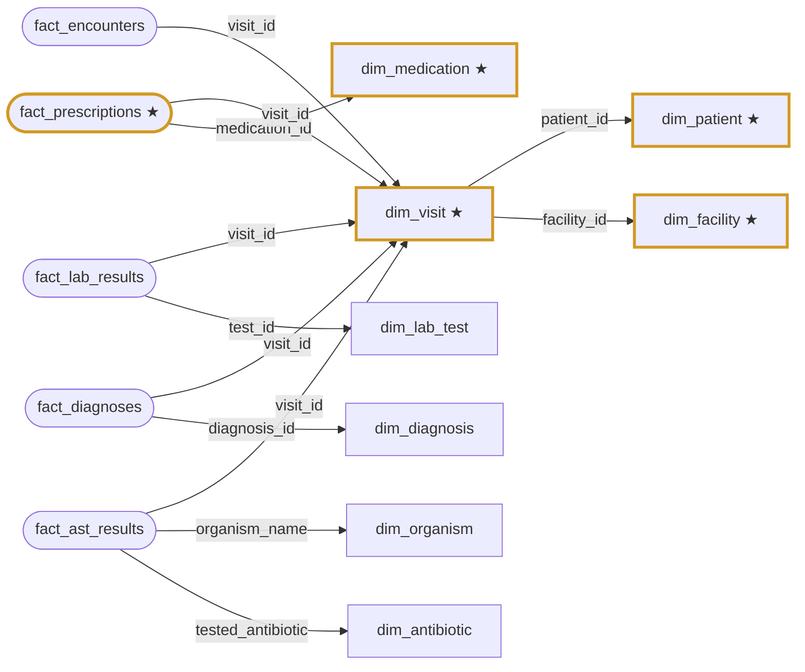

# Warehouse Constellation

Dataset **amu_inpatient_survey** feeds 31 columns across 5 tables (marked ★).

## dim_visit ★

spine; used by amr_surveillance, clinical_visit

| | column | type | role | datasets |
|---|---|---|---|---|
| ★ | **visit_id** | VARCHAR | key | amu_inpatient_survey |
| ★ | **patient_id** | VARCHAR | link | amu_inpatient_survey |
| ★ | **facility_id** | VARCHAR | link | amu_inpatient_survey |
| ★ | **visit_date** | DATE | attribute | amu_inpatient_survey |
| ★ | **admission_ward** | VARCHAR | attribute | amu_inpatient_survey |
|  | age_group | VARCHAR | attribute |  |
|  | visit_type | VARCHAR | attribute |  |
| ★ | **ward_type** | VARCHAR | attribute | amu_inpatient_survey |
|  | triage_urgency | VARCHAR | attribute |  |
| ★ | **age_years** | BIGINT | attribute | amu_inpatient_survey |
| ★ | **survey_date** | DATE | attribute | amu_inpatient_survey |

## dim_antibiotic

dimension; used by amr_surveillance

| | column | type | role | datasets |
|---|---|---|---|---|
|  | tested_antibiotic | VARCHAR | key |  |
|  | antibiotic_class | VARCHAR | attribute |  |

## dim_diagnosis

dimension; used by clinical_visit

| | column | type | role | datasets |
|---|---|---|---|---|
|  | diagnosis_id | VARCHAR | key |  |
|  | diagnosis_name | VARCHAR | attribute |  |
|  | icd10_code | VARCHAR | attribute |  |
|  | clinical_category | VARCHAR | attribute |  |

## dim_facility ★

dimension; used by amr_surveillance, clinical_visit

| | column | type | role | datasets |
|---|---|---|---|---|
| ★ | **facility_id** | VARCHAR | key | amu_inpatient_survey |
| ★ | **facility_name** | VARCHAR | attribute | amu_inpatient_survey |
| ★ | **facility_level** | VARCHAR | attribute | amu_inpatient_survey |
| ★ | **district** | VARCHAR | attribute | amu_inpatient_survey |
|  | region | VARCHAR | attribute |  |

## dim_lab_test

dimension; used by clinical_visit

| | column | type | role | datasets |
|---|---|---|---|---|
|  | test_id | VARCHAR | key |  |
|  | test_name | VARCHAR | attribute |  |

## dim_medication ★

dimension; used by clinical_visit

| | column | type | role | datasets |
|---|---|---|---|---|
| ★ | **medication_id** | VARCHAR | key | amu_inpatient_survey |
| ★ | **medication_name** | VARCHAR | attribute | amu_inpatient_survey |
| ★ | **antibiotic_class** | VARCHAR | attribute | amu_inpatient_survey |
| ★ | **aware_category** | VARCHAR | attribute | amu_inpatient_survey |

## dim_organism

dimension; used by amr_surveillance

| | column | type | role | datasets |
|---|---|---|---|---|
|  | organism_name | VARCHAR | key |  |

## dim_patient ★

dimension; used by amr_surveillance, clinical_visit

| | column | type | role | datasets |
|---|---|---|---|---|
| ★ | **patient_id** | VARCHAR | key | amu_inpatient_survey |
| ★ | **gender** | VARCHAR | attribute | amu_inpatient_survey |
|  | location_district | VARCHAR | attribute |  |

## fact_ast_results

fact; used by amr_surveillance — main fact of amr_surveillance

| | column | type | role | datasets |
|---|---|---|---|---|
|  | visit_id | VARCHAR | link |  |
|  | organism_name | VARCHAR | link |  |
|  | tested_antibiotic | VARCHAR | link |  |
|  | specimen_type | VARCHAR | attribute |  |
|  | mic_ug_ml | DOUBLE | measure |  |
|  | zone_diameter_mm | DOUBLE | measure |  |
|  | ast_interpretation | VARCHAR | attribute |  |
|  | is_mdr_isolate | BOOLEAN | attribute |  |

## fact_diagnoses

fact; used by clinical_visit

| | column | type | role | datasets |
|---|---|---|---|---|
|  | visit_id | VARCHAR | link | amu_inpatient_survey |
|  | diagnosis_id | VARCHAR | link |  |

## fact_encounters

fact; used by amr_surveillance, clinical_visit — main fact of clinical_visit

| | column | type | role | datasets |
|---|---|---|---|---|
|  | visit_id | VARCHAR | link | amu_inpatient_survey |
|  | length_of_stay_days | DOUBLE | measure |  |
|  | encounter_cost_ugx | DOUBLE | measure |  |
|  | prior_antibiotic_use_30d | VARCHAR | attribute |  |
|  | substance_use_history | VARCHAR | attribute |  |

## fact_lab_results

fact; used by clinical_visit

| | column | type | role | datasets |
|---|---|---|---|---|
|  | visit_id | VARCHAR | link | amu_inpatient_survey |
|  | test_id | VARCHAR | link |  |
|  | ast_interpretation | VARCHAR | attribute |  |
|  | zone_diameter_mm | DOUBLE | measure |  |

## fact_prescriptions ★

fact; used by clinical_visit — main fact of dataset amu_inpatient_survey

| | column | type | role | datasets |
|---|---|---|---|---|
| ★ | **visit_id** | VARCHAR | link | amu_inpatient_survey |
| ★ | **medication_id** | VARCHAR | link | amu_inpatient_survey |
|  | drug_cost_ugx | DOUBLE | measure |  |
| ★ | **drug_administration_route** | VARCHAR | attribute | amu_inpatient_survey |
| ★ | **diagnosis_icd10** | VARCHAR | attribute | amu_inpatient_survey |
| ★ | **dose_mg** | DOUBLE | measure | amu_inpatient_survey |
| ★ | **doses_per_day** | BIGINT | measure | amu_inpatient_survey |
| ★ | **treatment_days** | BIGINT | measure | amu_inpatient_survey |
| ★ | **indication_type** | VARCHAR | attribute | amu_inpatient_survey |
| ★ | **treatment_basis** | VARCHAR | attribute | amu_inpatient_survey |
| ★ | **culture_sent** | VARCHAR | attribute | amu_inpatient_survey |
| ★ | **specimen_type** | VARCHAR | attribute | amu_inpatient_survey |
| ★ | **organism_isolated** | VARCHAR | attribute | amu_inpatient_survey |
| ★ | **resistant_to_prescribed** | VARCHAR | attribute | amu_inpatient_survey |
